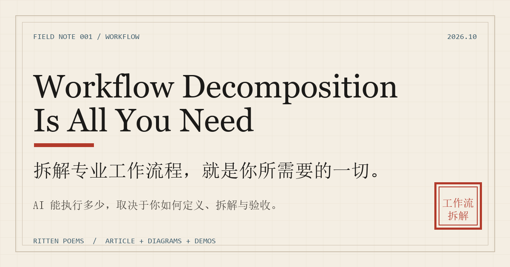

# Workflow Decomposition Is All You Need

**拆解专业工作流程，就是你所需要的一切。**

[在线站点](https://rittenpoems-beep.github.io/workflow-decomposition/) · [读文章](article/workflow-decomposition.md) · [下载工作表](templates/workflow-decomposition-worksheet.md)



AI 能帮你完成多么复杂的工作，仍然很大程度上取决于你作为「驾驶员」的水平。

但这里的水平，已经不再完全等同于你对某款专业软件的熟练程度。真正变得重要的，是你能不能把一个陌生领域拆成可执行、可检查、可验收的流程，然后在正确的节点做出判断。

这不是一本提示词手册。它是一份来自真实实验的**工作流拆解册**：三维、音乐、浏览器实时场景，以及那些没有走到交付的失败。

## 五分钟版本

### 五层结构

| 层 | 你要回答的问题 | 谁主导 |
|---|---|---|
| 定义 | 做什么、为谁做、什么算完成？ | 人 |
| 拆解 | 有哪些阶段、依赖和可并行的部分？ | 人 + AI |
| 选路 | 哪条技术路线最匹配交付物？ | 人 + AI |
| 执行 | 每个阶段具体怎么做？ | AI |
| 验收 | 这是不是我们要的东西？ | 人 |

### 四道闸门

1. **能运行**：进程成功、文件存在、格式正确。
2. **符合规格**：时长、尺寸、性能、指标在范围内。
3. **符合参照**：与参考同机位、同段落、同类型比较成立。
4. **愿意签字**：你愿意把它交给别人、署上名字。

大多数 AI 工作停在 1 和 2。**「能工作」不等于「值得交付」。**

### 一句话

> 你拥有一个装满世界上几乎所有工具的工具箱，却可能因为不知道螺丝刀的存在，而让 AI 一直尝试用锤子拧螺丝。

## 这个仓库里有什么

| 内容 | 入口 |
|---|---|
| **完整文章** | [article/workflow-decomposition.md](article/workflow-decomposition.md) |
| **方法论** | [docs/methodology.md](docs/methodology.md) |
| **证据与边界** | [docs/evidence.md](docs/evidence.md) |
| **拆解工作表** | [templates/workflow-decomposition-worksheet.md](templates/workflow-decomposition-worksheet.md) |
| **交互站点** | [site/index.html](site/index.html) |
| **在线演示** | [雨夜便利店 Three.js 场景](https://rittenpoems-beep.github.io/workflow-decomposition/demos/rainy-night-mart/) |

### 五个原创图示

| 图示 | 说明 |
|---|---|
| [三维制作工作流](site/assets/diagrams/workflow-3d.svg) | 八个阶段、六个验收闸门、失败回退 |
| [音乐制作工作流](site/assets/diagrams/workflow-music.svg) | 从参考分析到母带交付，含实测指标 |
| [路线分叉](site/assets/diagrams/route-divergence.svg) | 同一份简报，Three.js 与 Blender 的两种正确 |
| [杠杆结构](site/assets/diagrams/leverage-stack.svg) | 定义、拆解、选路、执行、验收，以及杠杆等式 |
| [验收闸门](site/assets/diagrams/acceptance-gates.svg) | 冒烟测试与完整验收，用三个真实案例举证 |

### 三个真实案例

| 案例 | 结论 | 读什么 |
|---|---|---|
| [同一份三维简报，两条技术路线](cases/01-threejs-vs-blender.md) | 路线由交付物决定，不由模型偏好决定 | 36.9 fps 背后的验收口径；为什么 Three.js 与 Blender 都可能是对的 |
| [当工具是对的，作品仍然不对](cases/02-ace-studio.md) | 冒烟测试全部通过，完整验收仍然失败 | ACE 人声实验、旋律与咬字返工、一次「听起来很诡异」的终止 |
| [能打开、能出图，然后呢](cases/03-delivery-gap.md) | 工程能打开、能渲染，不等于可交付 | Quiet Room 与 Alpine Drive 的交付缺口 |

## 交互站点

站点是纯静态的，没有构建步骤：

```bash
cd site
python -m http.server 8000
```

打开 <http://localhost:8000/>。

包含：

- **工作流地图**：三维 / 音乐 / 软件 / 视频四个领域，逐阶段查看输入、输出、AI 与人的分工、验收点与常见失败；
- **路线对照**：选择交付物，查看推荐路线与错误路线；
- **验收闸门**：在冒烟测试与完整验收之间切换，看结论如何变化；
- **拆解工作表**：填写后生成 Markdown，可复制或下载；
- **三维演示**：雨夜便利店 Three.js 场景（需联网加载 CDN）。

## 仓库结构

```text
workflow-decomposition/
├─ article/                 # 文章全文
├─ cases/                   # 三个案例
├─ docs/                    # 方法论与证据
├─ templates/               # 可填写的工作表
├─ site/                    # 静态站点
│  ├─ index.html
│  ├─ assets/
│  │  ├─ css/site.css
│  │  ├─ js/data.js
│  │  ├─ js/site.js
│  │  ├─ diagrams/          # 5 张原创 SVG
│  │  ├─ images/            # 案例图与封面
│  │  └─ audio/             # 15 秒作品
│  └─ demos/rainy-night-mart/
├─ .github/workflows/       # GitHub Pages 部署
├─ LICENSE                  # 代码：MIT
├─ LICENSE-CONTENT          # 文字与图示：CC BY 4.0
└─ CREDITS.md
```

## 边界

- 这些实验不构成「专业交付」的证明；案例中保留了未完成、未获认可与终止的状态。
- 36.9 fps、−9.18 LUFS 等数字是特定机器、特定版本的单次样本，不是通用承诺。
- 仓库不包含 BoyWithUke 的音频或歌词；参考只用于类型、结构与参数分析。
- 三维工程保留在本地；BWU v4 工程与下载的参考歌曲已于 2026-10-20 删除，均未随仓库分发。
- 详细说明见 [docs/evidence.md](docs/evidence.md)。

## 授权

- **代码**（站点、脚本、示例）：[MIT](LICENSE)
- **文字、图示、封面**：[CC BY 4.0](LICENSE-CONTENT)
- **15 秒音乐**：CC BY 4.0，署名见 [CREDITS.md](CREDITS.md)
- **第三方资产**：Three.js（MIT）、Poly Haven（CC0）；详见 [CREDITS.md](CREDITS.md)

---

*Ritten Poems · 2026.10*

> 在越来越多的领域，理解一项专业工作如何完成，正在成为亲自完成这项工作的入口。
