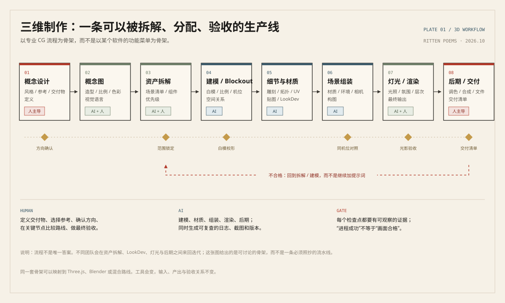
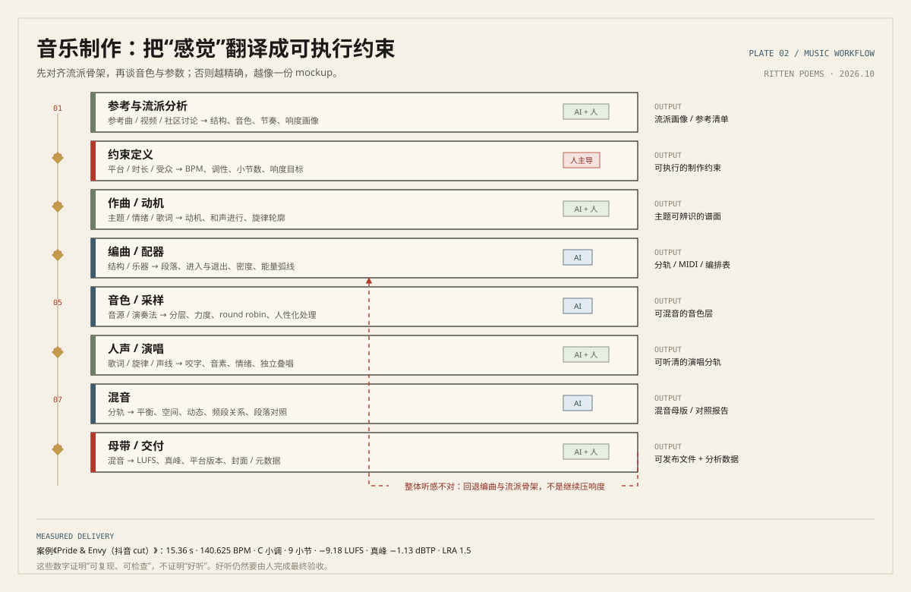
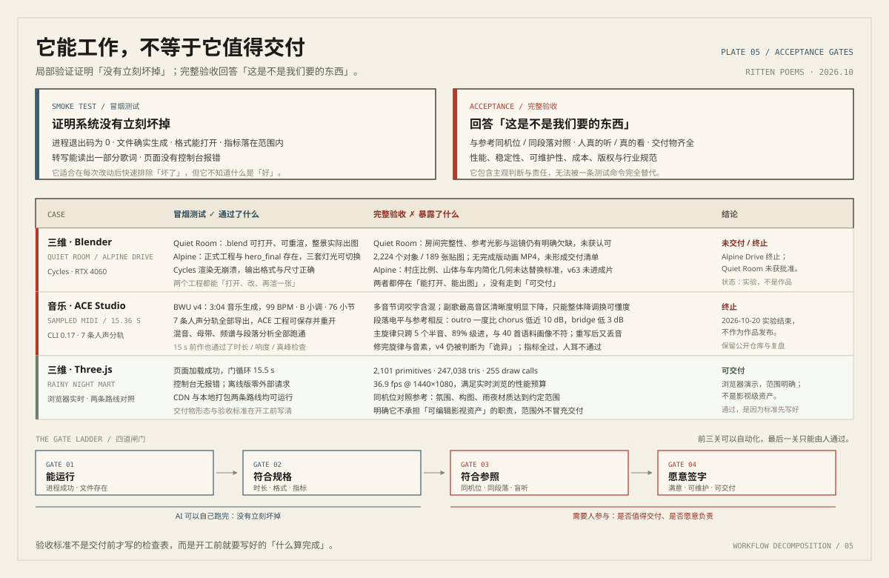
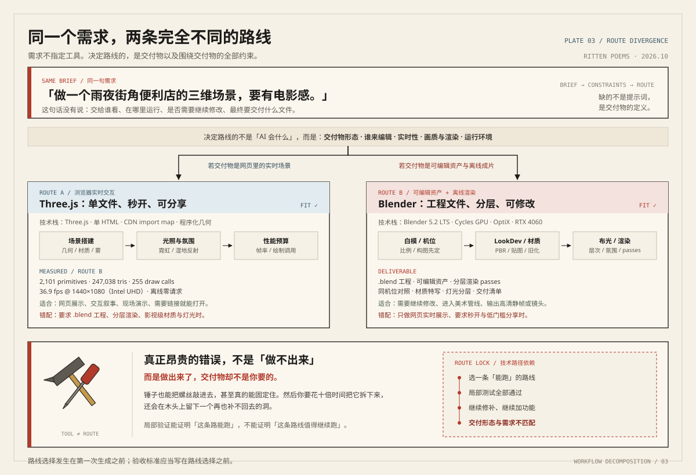
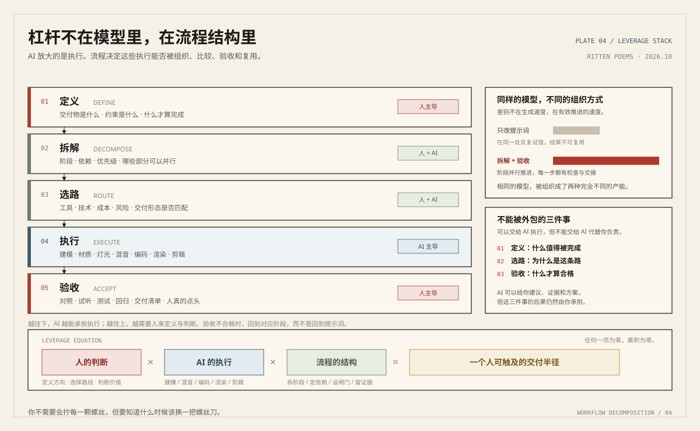

# Workflow Decomposition Is All You Need

*拆解专业工作流程，就是你所需要的一切。*

**Ritten Poems · 2026.10**

---

最近，我做了一些实验：尝试让 AI 使用 Blender 制作三维场景、完成建模与渲染，也尝试让它自主进行音乐设计与制作。

这些实验让我逐渐意识到一件事：

> **在今天，AI 能帮助你完成多么复杂的工作，仍然很大程度上取决于你作为「驾驶员」的水平。**

但这里的水平，已经不再完全等同于你对某款专业软件的熟练程度。

## 01. 从一句话许愿，到理解专业流程

最开始，我对三维制作几乎一无所知。

我可以直接告诉 AI：「帮我制作一个电影级写实的三维场景。」

它确实能够做出来。甚至对一个刚刚接触 Blender 的人而言，完成度已经相当惊人。

但作品仍然存在许多问题：构图平庸、材质缺乏真实感、灯光没有层次，整体看起来更像一次技术演示，而不是成熟的艺术作品。

起初，我试图通过不断修改提示词改善效果。

后来，我开始了解专业的三维制作流程。

我发现，在许多专业项目中，一件最终呈现给观众的三维作品，可能经历以下过程：

1. **概念设计**：确定风格、视觉语言、参考素材与整体构想。
2. **平面设计**：绘制概念图，明确造型、比例、结构与色彩。
3. **资产拆解**：把复杂场景拆分为可以独立制作的模型和组件。
4. **三维建模**：根据用途建立基础几何结构。
5. **雕刻与细化**：按项目需要使用 ZBrush 等工具增加细节，并处理拓扑、UV、贴图等工作。
6. **场景组装**：完成模型摆放、材质、环境与摄像机设置。
7. **灯光与渲染**：建立视觉层次，控制光照、氛围和最终输出。
8. **后期处理**：调整画面、合成效果，完成最终交付。

不同团队和项目的流程当然不会完全相同。

但关键在于：**这是一整套可以被理解、拆解、分配、执行和检验的工作流程。**

*图 1｜把专业 CG 流程画成生产线：每个阶段有输入、输出、执行者与验收点。*

过去，一个人想独立完成这一切，可能需要花费数年学习建模、雕刻、贴图、灯光、渲染等多个专业领域。

而今天，我可以尝试让 AI 分别承担其中的执行任务。

我不一定知道 Blender 里的每一个按钮在哪里，也不一定会使用 ZBrush 雕刻复杂模型。

但只要我开始理解专业团队是怎样完成工作的，我就有机会组织 AI 按照相同的逻辑推进项目。

这就是我最近感受到的巨大变化。

## 02. 这不只是三维制作

音乐也是一样。

我最开始让 AI 制作音乐时，甚至很难准确描述自己想要的声音。

我知道一首曲子听起来应该是什么感觉，却不知道如何把这种感觉变成可执行的制作要求。

后来，我开始接触编曲、配器、音色设计、MIDI、混音、母带处理等概念。

于是，我逐渐能够理解一首音乐作品是怎样被生产出来的。

哪些部分需要先设计？哪些部分能够独立完成？什么环节需要反复试听？最后应当如何组合、调整与输出？

我不需要立即成为一名专业音乐制作人，才能开始利用这些知识。

*图 2｜音乐不是「生成一段音频」，而是一条从参考、约束、动机到混音与母带的链路。*

同样的情况发生在平面设计、影视制作和软件工程中。

一个完整的软件产品，也可以按照需求分析、架构设计、前后端实现、数据库设计、测试、部署、运维等阶段展开。

以前，掌握其中任何一个专业领域，都需要大量学习、实践和积累。

**现在，很多执行任务可以交给 AI，而我们获取这些领域工作流程知识的成本，已经远远低于亲自掌握全部操作技能的成本。**

更重要的是，这种方法具有跨领域迁移能力。

当你习惯于拆解任务、查找行业标准、组织执行与检查结果之后，就可以把类似的方法应用到一个又一个陌生领域。

## 03. 被重新分配的专业能力

这并不意味着专业知识已经没有价值。

恰恰相反，我认为专业知识正在以另一种方式变得重要。

假设两个从未学习过三维制作的人，使用同样的 AI 模型和同样的软件。

第一个人只会不断提出要求：

「更真实一点。」

「更有电影感。」

「再高级一点。」

第二个人则会先研究参考作品，确定艺术方向，拆解场景资产，明确材质标准，设计布光方案，并在每个阶段检查结果。

即使两个人都不会亲自操作复杂的三维软件，最终产物也很可能产生显著差距。

这说明一个问题：

> **AI 可以代替大量操作，但你仍然需要知道什么应该被完成、怎样组织完成，以及如何判断它是否合格。**

过去，我们必须通过长期练习积累操作熟练度。

现在，一部分操作熟练度可以由 AI 提供。

而理解流程、表达需求、做出判断、发现错误和不断迭代，开始成为跨专业工作的重要能力。

你不需要在每一个领域都成为专家，才有机会开始做出作品。

当然，能够做出 Demo，并不代表已经具备专业交付能力。

真实项目还有性能、稳定性、可维护性、成本、版权、安全与行业规范等要求。专业人士积累的隐性经验，也并不是画出一张流程图就能全部获得。

但至少，对大量数字化工作而言，**进入一个专业领域并做出第一个可观成果的门槛，已经出现了实质性的下降。**

*图 3｜「能运行」与「值得交付」之间，隔着参照、品味与责任。*

## 04. 那为什么不让 AI 自己拆解？

写到这里，我想一定会有人提出一个问题：

「既然 AI 已经这么强大，为什么还需要我自己去学习这些专业流程？我直接让 AI 自己研究、自己选择工具、自己完成不就行了吗？」

这是一个很合理的质疑。

事实上，我最开始就是这么做的。

我把目标交给 AI，允许它自行规划、选择工具、调用软件、检查结果，甚至在不需要人工干预的情况下持续工作数个小时。

理论上，这应该是一个相当理想的方案。

现代 AI 掌握着极其广泛的技术知识。它知道大量软件、编程语言、开发框架和专业工具，也可以借助搜索、文档和测试不断补充信息。

它所能够接触到的技术路线，远远超过我个人所了解的范围。

**那么，为什么最终的结果仍然经常不尽如人意？**

我最近的一次音乐制作实验给了我一些启发。

当时，AI 正在使用 ACE Studio 完成音乐制作。我观察了它的操作过程后，对这个工具是否适合整个制作流程产生了怀疑。

我不懂专业音乐制作，也没有足够的经验来判断它是不是正确的选择。

但我仍然询问 AI：

「你用着怎么样？要不要我给你重新下一个？我觉得它不太专业。」

AI 给我的回答非常肯定。

它认为完全没有必要更换软件，因为 ACE Studio 足够专业，能够满足当前制作任务的大部分需求。

然而，随着制作不断推进，我发现最终效果与自己的预期仍然存在明显差距。

这并不能证明 ACE Studio 本身不专业，也不能说明换一个软件就一定会更好。

真正值得注意的是：**AI 对现有工具的肯定，并没有建立在充分比较其他制作路线的基础上。**

它可以检查某个功能是否存在，尝试某种操作能否成功，运行测试验证流程是否正常。

但这种局部验证，并不等于它已经找到了最适合目标的整体方案。

就像软件工程里的冒烟测试。

一个程序成功启动、主要功能可以运行，并不能证明它的架构合理、性能优秀，或者它就是解决问题的最佳选择。

我在三维制作领域也遇到了相似的问题。

假设一个人完全不了解三维技术。

他不知道 Blender、3ds Max、CAD，也不理解 Three.js 与专业三维内容创作软件的不同定位。

当他要求 AI 制作一个三维场景时，AI 完全可能选择自己容易生成和执行的技术路线，例如直接编写 Three.js 场景。

这当然不意味着 Three.js 不专业。

如果目标是浏览器中的实时交互展示，它甚至可能是非常合适的选择。

但如果目标是制作可编辑的复杂三维资产、完成高质量离线渲染，或者交付可以进入专业美术管线的工程文件，情况就完全不同了。

**问题不在于 AI 没有能力使用更合适的工具，而在于它未必会主动发现自己选错了工具。**

它可能已经找到了一条能够完成任务的路线，于是不断在这条路线上修补问题、增加功能、进行测试。

每一个步骤看起来都合理，每一次修改似乎都在向目标前进。

但整条路线可能从一开始就不适合最终需求。

这让我想到一个非常直观的比喻：

> **你拥有一个装满世界上几乎所有工具的工具箱，却可能因为不知道螺丝刀的存在，而让 AI 一直尝试用锤子拧螺丝。**

它甚至有可能真的设计出某种用锤子拧动螺丝的方法。

然后认真地告诉你：看，它可以工作。

可问题是，为什么不用螺丝刀呢？

*图 4｜需求不指定工具；交付物、编辑方式、实时性与画质，才决定路线。*

我目前的猜想是，这里面存在一种技术路径依赖。

AI 很善于在已经确定的目标、上下文和工具环境中继续执行、发现问题、修复错误。

但它不一定会在每个关键节点主动重新比较所有可能的技术路线，更不一定能在缺少明确验收标准时，准确判断当前路线是否值得继续投入。

当然，这不是 AI 永远无法解决的问题。

如果我们明确要求它比较不同方案、查询专业工作流、制定验收标准，并允许它推翻自己先前的选择，结果可能明显改善。

未来更强大的 AI，也完全可能拥有更加成熟的自主规划与路线选择能力。

但至少在我目前的实践里，让 AI 自主完成一切，并不总是比我先了解一点专业知识、再指导它执行更加有效。

所以，我开始修正自己最初的想法。

**我们不一定需要学习如何亲手操作所有工具，但仍然值得学习专业人士为什么选择这些工具，以及他们为什么按照这样的流程工作。**

因为只有知道还存在其他可能性，我们才更容易意识到眼前这条路或许根本不值得走下去。

我可以让 AI 帮我拆解专业工作流程，也可以让它研究和比较不同的软件。

但如果我自己对这个行业一无所知，我甚至可能不知道应该要求它进行这样的比较。

这就是我认为人类暂时仍然需要掌握一些专业认知的原因。

不是为了亲自执行每一个步骤。

而是为了在必要时，有能力提出一个问题：

> **「我们为什么一定要这样做？有没有更合适的方法？」**

## 05. 一个极其夸张的杠杆

这也是我认为 AI 真正具有革命性潜力的地方。

过去，如果你想将一项专业服务的产能提高十倍，往往需要更多熟练人员、更完善的培训、更高效的工具和更复杂的组织管理。

现在，我们多了一种可能：

将专业工作拆解为可执行的流程，再利用 AI 承担其中大量耗时、重复或技术密集的环节。

一个人有机会完成过去需要多人协作才能完成的部分工作。

小型团队也有机会触及过去因为人力成本太高而无法进入的市场。

如果这种效率提升能够持续转化为更低的生产成本，并通过竞争传递到市场，许多数字产品与服务的价格就有进一步下降的空间。

这当然不适用于所有行业。

涉及物理操作、重大安全责任、严格监管或复杂现实环境的工作，仍然存在无法轻易绕过的约束。

但在软件开发、设计、内容制作、数据处理以及大量数字化业务中，这种变化已经值得我们认真对待。

更让我兴奋的是，它让一个人的探索范围变得前所未有地宽广。

一个对音乐感兴趣的程序员，可以开始尝试制作音乐。

一个没有专业建模经验的创作者，可以开始设计复杂的三维场景。

一个不懂前端框架的普通人，可以尝试制作自己的软件产品。

他们的第一个作品未必优秀，也未必能够商业化，但他们终于可以以一种低得多的成本，把想法变成能够运行、观看、聆听和验证的东西。

*图 5｜同样的模型，被组织成不同的流程，就会产生完全不同的交付半径。*

## 06. Workflow Decomposition Is All You Need

这个标题当然是一种夸张。

仅仅知道一个行业的流程，还不足以掌握整个行业。

理解专业流程也不代表拥有专业审美、经验、创造力或者承担责任的能力。

但它已经足够成为一个极其有价值的起点。

当你面对一个完全陌生的领域时，你可以先研究：

这个领域的专业人士究竟是如何工作的？

他们通过哪些环节把原始需求变成最终作品？

每个环节需要什么输入，产出什么结果？哪些任务可以被 AI 执行？哪些地方需要人类判断？又应该采用什么标准验收？

当这些问题逐渐清楚，原本遥不可及的专业工作就会变成一组可以尝试执行、不断验证和逐步优化的任务。

而 AI 正在让这种尝试的成本持续降低。

我认为，这将深刻改变人类学习技能、组织劳动和创造产品的方式。

> **在越来越多的领域，理解一项专业工作如何完成，正在成为亲自完成这项工作的入口。**

*Workflow Decomposition Is All You Need.*

---

## 继续阅读

这篇文章背后是三次真实实验，包括它们失败、返工和终止的部分：

- [同一份三维简报，两条技术路线](../cases/01-threejs-vs-blender.md)：Three.js 与 Blender 的路线分叉，以及 36.9 fps 背后的验收口径。
- [当工具是对的，作品仍然不对](../cases/02-ace-studio.md)：ACE Studio 音乐实验，从冒烟测试全部通过，到 v4 被判断为「诡异」。
- [能打开、能出图，然后呢](../cases/03-delivery-gap.md)：Quiet Room 与 Alpine Drive 的交付缺口。

也可以直接使用 [工作流拆解工作表](../templates/workflow-decomposition-worksheet.md)，把下一个陌生领域拆成可执行、可验收的阶段。
