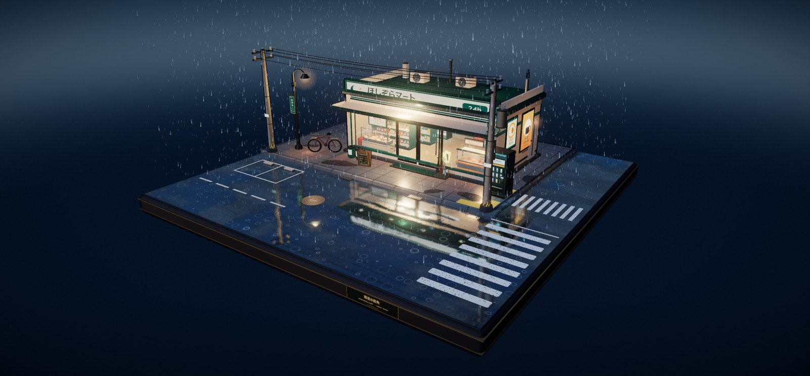
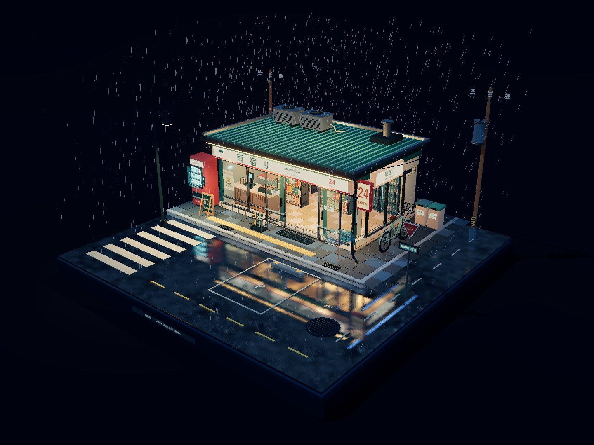

# 同一份三维简报，两条技术路线

**案例 01｜Three.js 与 Blender 的路线分叉**

同一句需求：

> 做一个雨夜街角便利店的三维场景，要有电影感。

如果只把这句话交给 AI，它会选一条自己最容易执行的路线。真正决定结果的，不是提示词写得多长，而是在开工前有没有回答：**这个场景最终以什么形态交付？谁要继续编辑它？它在哪里运行？**

## 两条路线，各自的正确答案

| | Route A · Three.js 单文件 | Route B · Blender + Cycles |
|---|---|---|
| 交付物 | 一个可直接打开的网页场景 | `.blend` 工程、可编辑资产、离线渲染 |
| 运行方式 | 浏览器实时渲染 | 离线渲染成图 / 帧序列 |
| 交互 | 拖拽旋转、缩放、平移 | 在 Blender 内编辑 |
| 修改成本 | 改代码、重新加载 | 改资产、材质、灯光、重新渲染 |
| 适合 | 网页展示、交互叙事、现场演示 | 影视资产、静帧、镜头、进入美术管线 |
| 不适合 | 交付影视级可编辑资产 | 要求秒开、可分享、实时交互的网页 |

这两条路线都不是「更专业」的路线，它们只是对应不同的交付物。

- 如果目标是**浏览器里的实时场景**，Three.js 是合适的。它可以把几何、材质、灯光、动画全部程序化生成，交付一个单文件或离线打包的 HTML。
- 如果目标是**可编辑的复杂资产与高质量离线渲染**，Blender + Cycles 是合适的。它提供真实的可编辑工程、PBR 材质、灯光、分层渲染与资产管线。

错误通常不是「选了一个不专业的工具」，而是**用一条路线的交付物，去验收另一条路线的成果**。

## Route A 实际交付了什么

雨夜便利店做了两套独立实现，用来验证同一份简报在不同工程约束下的差异。

### Route A · 单文件 / CDN

- 单文件 `index.html`，通过 import map 从 jsDelivr 加载 Three.js r170 与官方 addons。
- 程序化几何、材质、灯光与动画；没有 Blender，没有预制三维模型。
- 反向外壳描边、4 级渐变三渲二、`Reflector` 湿地倒影、两层 GPU 雨点（4,200 + 900）。
- 自动门以 15.5 秒周期开合；雨、屋檐滴水、水洼涟漪、招牌微闪持续运行。
- 在 Edge 中实机运行，控制台无错误；初始构图完整显示正方形底座与两根电线杆；鼠标旋转、滚轮缩放、右键平移均已检查。

### Route B · 离线打包 / 合并几何

- Three.js r170 与 addons 通过 npm 安装后，用 esbuild 内嵌进单个 HTML。
- 静态几何按材质合并，建筑线条合并成单个 `LineSegments`。
- 离线运行，`externalRequests: []`，`errors: []`。
- 门体断言：`t=2` 关闭、`t=7` 开启、`t=12` 关闭、`t=22` 再次开启。
- 1440×1080、Intel UHD 实机样本：**2,101 个图元、247,038 三角形、255 draw calls、36.9 fps**。
- 旋转、缩放、平移与竖屏自适应均通过断言。

## 为什么这算一次通过验收的交付

因为它在一开始就把验收口径限定在「浏览器实时演示」：

- 能打开、能交互、无控制台错误；
- 在约定的分辨率与硬件上有可用的帧率；
- 离线版本没有外部请求；
- 视觉上达到约定的雨夜氛围与构图，而不是冒充影视级写实资产。

它不承担「可编辑影视资产」的职责，所以也没有用那张标准去判它失败。

反过来，Quiet Room 与 Alpine Drive 用的是 Blender 路线，工程能打开、能渲染，却仍然没有通过完整验收。原因不在工具，而在交付缺口。详见 [案例 03](03-delivery-gap.md)。

## 路线选择的五个问题

在让 AI 开始生成之前，先问：

1. **最终交付物是什么？** 网页、图片、视频、工程文件，还是可继续编辑的资产？
2. **谁来编辑它？** 只有你、另一个设计师、一个团队，还是根本不会再改？
3. **需要实时吗？** 实时交互与离线渲染是两种完全不同的性能预算。
4. **画质上限在哪里？** 风格化实时、影视静帧、动画镜头，对应的材质与灯光标准不同。
5. **它要进入哪条管线？** 浏览器、剪辑软件、游戏引擎、DCC 工程，还是只存在于聊天窗口里？

这些问题的答案，比「用 Blender 还是 Three.js」更重要。它们才是路线选择的输入。

## 可复用的结论

- **路线由交付物决定，不由模型偏好决定。** AI 倾向于选择自己容易生成和验证的路线；这条路线可能「能跑」，但不一定匹配最终交付物。
- **同一份简报可以有多条正确路线。** 关键是把每条路线的交付物、成本与验收标准写清楚。
- **验收标准要在开工前写。** 如果先用 Three.js 做完，再要求它变成可编辑的 `.blend`，那不是验收，是换项目。
- **在错误路线上修补，成本会指数增长。** 越早发现路线不匹配，迁移越便宜。

---

**证据与产物**

- 在线演示：[雨夜便利店 Three.js 场景](../site/demos/rainy-night-mart/index.html)（需要联网加载 Three.js CDN）
- 图示：[路线分叉](../site/assets/diagrams/route-divergence.svg)
- 原始项目：`rainy-night-mart`（本地工程，包含两套实现的源码、验证记录与截图）
- 技术栈：Three.js r170、esbuild、Edge、Intel UHD 实机验证
