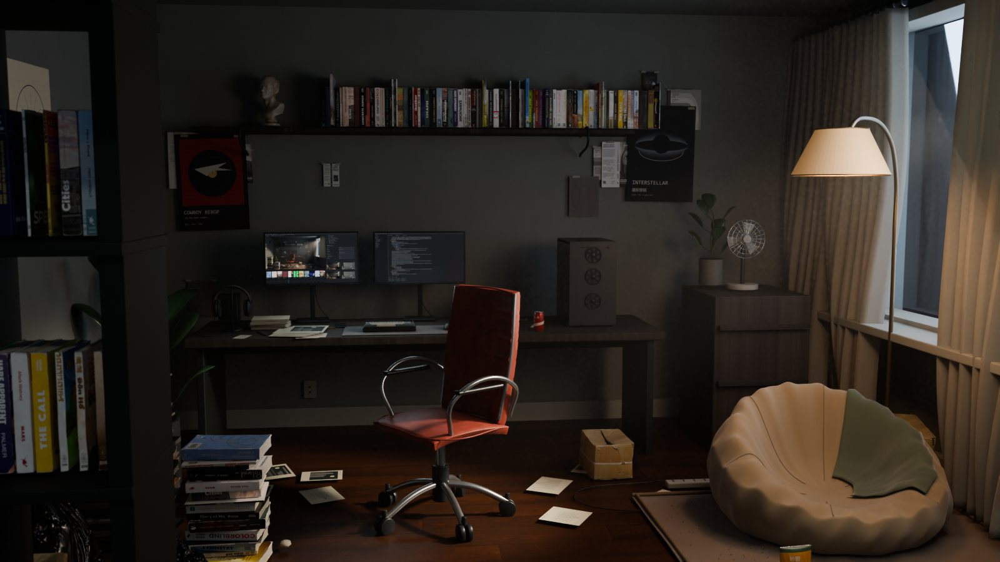
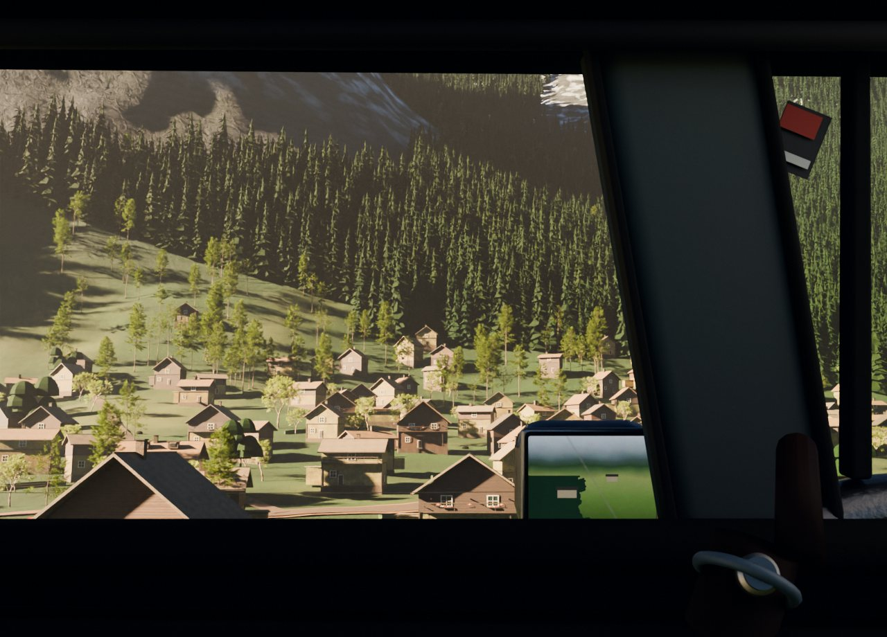
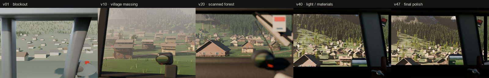
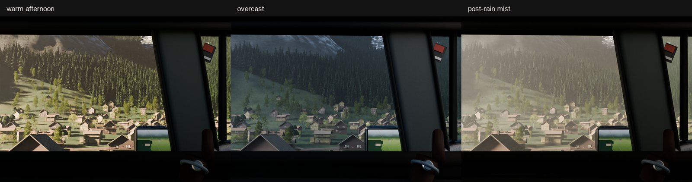

# 能打开、能出图，然后呢

**案例 03｜Quiet Room 与 Alpine Drive 的交付缺口**

这是两个 Blender 项目的真实状态。它们都不是「失败到没有任何产物」，恰恰相反：

- 工程能打开；
- 场景能渲染；
- 有拿得出手的静帧；
- 有材质、灯光、相机、动画曲线；
- 有过程记录、失败日志和阶段文件。

但它们都没有走到「可交付」。

## 两个项目

### Quiet Room / 风经过无人房间

目标：根据用户给出的室内完成图与结构图，在 Blender 中搭建一个可编辑场景，输出原生 CG 与少量风动。

完成的部分：

- `Quiet_Room.blend` 主工程，资产贴图打包，保留对象、材质、相机、灯光、窗帘形态键与原生动画曲线；
- 1600×900 整景与 1800×1100 外设近景均实际渲染成功；
- 2,224 个对象、189 张打包图像，未发现缺失贴图；
- Outliner 按 Architecture、Desk、Hero chair、Scanned props、Books、Wall artwork、Wind animated linen、Lighting 等集合组织；
- 阶段文件、白模图、灯光预览、渲染记录与失败日志都保留。

没有完成的部分：

- **房间完整性、参考图光影和运镜仍有明确欠缺**；
- 原定的 6 秒动画 `Quiet_Room_6s.mp4` 没有完成，不作为交付；
- 高清渲染曾出现黑帧与 GPU / 共享内存不足，修复后仍有性能与稳定性风险；
- 没有形成最终的资产清单、渲染分层与交付说明；
- **用户没有给出最终认可。**

### Alpine Drive / 车窗里的阿尔卑斯

目标：以一张车内视角的参考照片，完成阿尔卑斯山村的三维场景。

完成的部分：

- 1280×920 最终成片，Cycles GPU（RTX 4060 / OptiX），72 采样 + OpenImageDenoise，AgX Medium High Contrast；
- 约 4.4 km × 2.7 km 的分形地形与村庄台地，三十余栋 hero chalet 与程序化 infill；
- 对岸森林约 5.5 万棵实例化针叶树；
- 三套同机位灯光方案：暖午后、阴天、雨后薄雾；
- 白模 / 灰阶体块校形、版本演化对照、调色前后对照；
- 正式工程 `Alpine_Drive_final.blend` 可打开重渲，使用 Poly Haven CC0 资产，并有 manifest。

没有完成的部分：

- 村庄比例和重复度仍偏「模型感」，地面拼块与草地质感偏规整；
- 山体岩壁层理、雪沟和逆光体积感不足；
- 车内 A 柱、后视镜与手部仍是简化几何；
- v63 的写实重做没有达到替换正式图的标准；
- 计划中的中性灰 clay render 没有完成；
- **项目于 2026-10-20 终止。**

## 冒烟测试与完整验收

| | Quiet Room | Alpine Drive |
|---|---|---|
| 工程能打开 | ✓ | ✓ |
| 能渲染出图 | ✓ | ✓ |
| 材质 / 灯光 / 相机齐全 | ✓ | ✓ |
| 有阶段文件与过程记录 | ✓ | ✓ |
| 达到参考图的光影与构图 | ✗ 仍有明确欠缺 | ✗ 写实度未达替换标准 |
| 有完成版动画 / 镜头 | ✗ 无 MP4 | ✗ 只有静帧 |
| 资产、命名、分层、清单可交接 | ✗ 未形成 | 部分（工程与 manifest） |
| 用户最终认可 | ✗ | ✗（终止） |

这就是「能工作」与「值得交付」之间的差距。

## 为什么「能出图」会骗人

渲染出一张好看的图，会给人一个强烈的完成感。但它只证明了一件事：**在这个机位、这个分辨率、这一次渲染里，画面没有坏。**

它不能证明：

- 换一个机位还成立吗？
- 换一个分辨率、换一台机器还能稳定渲染吗？
- 资产命名、集合、材质、贴图路径能让另一个人接手吗？
- 动画、分层、合成 passes 齐了吗？
- 画面里的问题，是这一张图的问题，还是整个场景的问题？
- 用户真正想要的，是这张图，还是一个可以继续修改的工程？

Quiet Room 的 2,224 个对象与 189 张打包图像，说明它已经是一个复杂工程；但复杂本身不是交付。**没有清单、没有分层、没有最终认可，复杂只是接手成本。**

Alpine Drive 的 `hero_final.png` 很完整，`Alpine_Drive_final.blend` 也能打开；但项目仍然终止，因为「有一张能看的成片」不等于「达到参考标准并值得继续投入」。

## 交付缺口清单

一个三维项目从「能出图」走到「可交付」，至少还要补上：

1. **范围**：交付的是静帧、动画、工程，还是三者都要？
2. **资产**：命名、集合、相对路径、贴图打包、缺失检查；
3. **渲染**：分辨率、采样、降噪、色彩管理、分层 passes；
4. **动画**：帧率、时长、相机、循环、缓存；
5. **文档**：打开方式、重建方式、已知问题、依赖与许可；
6. **验收**：同机位对照、材质特写、光影层次、性能与稳定性；
7. **签字**：用户真的认可，而不是「先这样吧」。

任何一项缺失，都可能在交付后变成返工。

## 可复用的结论

- **工程能打开，是最低标准，不是完成标准。**
- **静帧通过，不代表场景通过。** 机位、分辨率、光线、资产组织都会改变结论。
- **过程记录很有价值，但它证明的是「做过」，不是「做好」。**
- **终止一个不达标的项目，是正常的交付决策。** 比把未完成的东西包装成成品更诚实。
- **验收标准要在开工前写。** 如果一开始就写清「参考图光影、房间完整性、6 秒动画、可交接工程」，就不会在最后才发现缺口。

---

**证据与产物**

- Quiet Room：`Quiet_Room.blend`、`renders/Quiet_Room_Student.png`、`HANDOFF.md`、`evidence/`（本地工程）
- Alpine Drive：`Alpine_Drive_final.blend`、`renders/hero_final.png`、`renders/process_versions.png`、`assets/manifest.json`（本地归档）
- 图片：[Quiet Room](../site/assets/images/quiet-room.jpg)、[Alpine 成片](../site/assets/images/alpine-final.jpg)、[版本演化](../site/assets/images/alpine-process.jpg)、[灯光对照](../site/assets/images/alpine-lighting.jpg)
- 资产：Poly Haven 扫描模型与贴图，CC0；其余几何、材质、灯光、相机在项目内生成
